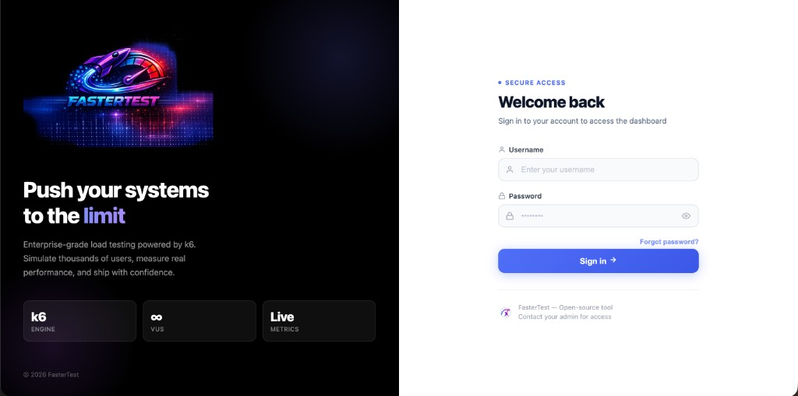
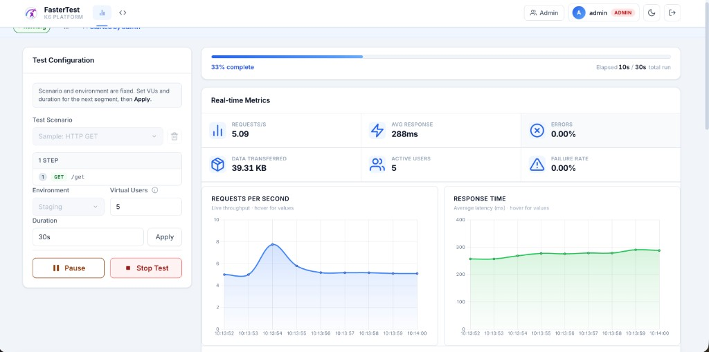

# FasterTest

<p align="center">
  
</p>

<p align="center">
  <b>Open-source load and stress testing platform powered by the k6 engine</b><br />
  Self-hosted web control plane · live metrics · cURL import · JWT &amp; RBAC · MySQL · Docker
</p>

<p align="center">
  <a href="https://github.com/alirezaedalat/fastertest/actions/workflows/ci.yml"></a>
  <a href="./LICENSE"></a>
  <a href="./package.json"></a>
  <a href="https://k6.io"></a>
  <a href="https://github.com/alirezaedalat/fastertest/stargazers"></a>
</p>

> **Independence notice:** FasterTest is an independent open-source project that uses the k6
> load-testing engine. Grafana, k6, and their associated marks are trademarks of Grafana Labs.
> FasterTest is not affiliated with, endorsed by, or sponsored by Grafana Labs. FasterTest is not an
> official Grafana or k6 product. FasterTest application source remains under the
> [ISC License](./LICENSE); k6 remains under its own license (AGPL-3.0). Bundled third-party
> components retain their own licenses — see [THIRD_PARTY_NOTICES.md](./THIRD_PARTY_NOTICES.md).

---

## Screenshots

<p align="center">
  
  <br />
  <em>Login — secure access to the FasterTest dashboard</em>
</p>

<p align="center">
  
  <br />
  <em>Live run — VUs, duration, throughput, latency charts, Pause / Stop / Apply load updates</em>
</p>

---

## Table of contents

- [Screenshots](#screenshots)
- [What is FasterTest?](#what-is-fastertest)
- [Why FasterTest?](#why-fastertest)
- [Who is it for?](#who-is-it-for)
- [Features (complete)](#features-complete)
- [How it works](#how-it-works)
- [Quick Start](#quick-start)
- [Using the product](#using-the-product)
- [Roles & permissions](#roles--permissions)
- [Configuration reference](#configuration-reference)
- [Docker](#docker)
- [Deploy on a Linux VM](#deploy-on-a-linux-vm)
- [Storage model](#storage-model)
- [API & WebSocket overview](#api--websocket-overview)
- [Project layout](#project-layout)
- [Scripts & commands](#scripts--commands)
- [Troubleshooting](#troubleshooting)
- [Limitations](#limitations)
- [Security notes](#security-notes-operators)
- [Documentation](#documentation)
- [Contributing](#contributing)
- [License](#license)

---

## What is FasterTest?

**FasterTest** is a self-hosted web application that sits on top of [k6](https://k6.io). Your team
opens a browser, signs in, picks a scenario (or imports a cURL), sets VUs and duration, and clicks
**Start**. FasterTest runs **k6 as a child process on the server** and streams live metrics, logs,
and status back to the UI over WebSocket.

It is **not** a SaaS product and **not** a hosted load-generator farm. You own the machine (or
container) that generates traffic. That keeps data on your infrastructure and makes FasterTest a
good fit for internal QA / SRE / platform teams.

| Layer             | Responsibility                                 |
| ----------------- | ---------------------------------------------- |
| Browser UI        | Auth, start/stop/pause, charts, history, admin |
| FasterTest server | JWT/RBAC, orchestration, reports, storage      |
| k6                | Actual HTTP(S) load against your target APIs   |

---

## Why FasterTest?

Most teams still run k6 from the CLI. That works for experts — and breaks down for collaboration.

| Without FasterTest                            | With FasterTest                                   |
| --------------------------------------------- | ------------------------------------------------- |
| Shared scripts + tribal CLI knowledge         | Pick scenario → set VUs/duration → **Start**      |
| Hard to onboard PMs / QA without CLI          | Invite link + role-based UI                       |
| Live output = SSH + terminal scrollback       | Live metrics & logs in the browser                |
| cURL → hand-written k6                        | **cURL import** (single or multi-step chain)      |
| No shared run history                         | History, JSON/HTML reports, disk retention        |
| Weak access control around who can blast prod | JWT, roles, teams, modes, optional VU caps, audit |

---

## Who is it for?

- **QA / performance engineers** who want a shared panel instead of ad-hoc CLI runs
- **Backend / platform teams** that already use k6 scripts and need RBAC + history
- **SRE / DevOps** who want a Docker-friendly self-hosted control plane
- **Open-source contributors** extending UI, scenarios, or security hardening

If you need multi-region distributed generators, cloud agent fleets, or a fully managed SaaS, this
project is intentionally smaller — see [Limitations](#limitations).

---

## Features (complete)

### Web dashboard

- Vue 3 UI with Chart.js live charts and a terminal-style output panel
- **Test Scenarios** tab — list built-in and imported scenarios (team-filtered)
- **Import cURL** tab — paste a cURL or a multi-step chain
- Dark mode, responsive layout, login / invite / reset pages
- Dev mode serves Vue/Chart from `/vendor/*`; production uses `npm run build:ui` bundle

### Test execution

| Action          | What happens                                                 |
| --------------- | ------------------------------------------------------------ |
| **Prepare**     | Claims a short lock so two people do not start at once       |
| **Start**       | Spawns `k6 run` with VUs, duration, env, optional custom env |
| **Stop**        | Sends SIGTERM to the active k6 process                       |
| **Pause**       | Stops current segment; remaining duration saved for resume   |
| **Resume**      | Starts a new k6 segment and merges metrics                   |
| **Update load** | Restarts a segment with new VUs and/or duration              |

Important: pause / resume / update-load are **segmented**. FasterTest does **not** pause k6
in-process. VU memory, iterations mid-flight, and script globals are not preserved across segments.
`setup()` / `teardown()` may run again. Details: [docs/BEST_PRACTICES.md](./docs/BEST_PRACTICES.md).

Other execution details:

- **One active k6 process** per FasterTest instance
- Global caps (defaults): up to **1000 VUs**, duration up to **24 hours** (see constants)
- Optional **per-user** `maxVus` / `maxDurationMinutes`
- Environments typically `staging` / `production` (via `ENV` + `BASE_URL`)
- Built-in demo: **Sample: HTTP GET** → [httpbingo.org](https://httpbingo.org) (override with
  `BASE_URL`)

### Scenarios & cURL import

- Drop `.js` files into `tests/scenarios/` — they appear in the UI (optional `@team` metadata)
- **Single cURL import** → generates a k6 scenario file and registers it immediately
- **cURL chain** → multi-step flows in one scenario
- Modes: users can be limited to `scenario`, `curl`, or both
- Imported cURL scenarios currently **do not** support pause/resume
- Admins can delete imported scenario files via API/UI paths documented in
  [docs/API.md](./docs/API.md)

### Authentication & accounts

| Capability      | Detail                                                                    |
| --------------- | ------------------------------------------------------------------------- |
| Login           | JWT (default **24h**), stored in browser, sent as `Authorization: Bearer` |
| Invite          | Admin creates link; user accepts at `/invite?token=…` (TTL **7 days**)    |
| Password reset  | Admin generates link; user opens `/reset?token=…` (TTL **2 hours**)       |
| Password policy | 8+ chars, uppercase, digit, special character                             |
| Lockout         | 5 failed logins / user → 15 min; 20 / IP → 15 min                         |
| Session revoke  | `tokenVersion` bump invalidates older JWTs / WS sessions                  |
| Email domain    | Optional `ALLOWED_EMAIL_DOMAIN`                                           |

There is **no self-serve “forgot password” email** — reset links are issued by an admin.

### Roles, teams, modes & limits

Roles: `admin`, `tech-lead`, `developer`, `qa`, `pm`.

| Control    | Behavior                                                                                                     |
| ---------- | ------------------------------------------------------------------------------------------------------------ |
| **Teams**  | Filter which scenarios a user sees (`api`, `backend`, `frontend`, `platform`, `qa`). Empty list = all teams. |
| **Modes**  | `scenario` and/or `curl`. Empty = both. Admins & tech-leads bypass mode checks.                              |
| **Limits** | Optional max VUs / max duration minutes (admins unlimited).                                                  |
| **Bans**   | Per-user suspend; ban-all / unban-all non-admins; **global login ban**.                                      |

See [Roles & permissions](#roles--permissions) below.

### Live metrics, history & reports

- WebSocket stream: status, metrics points, stdout/stderr lines, prepare/start/stop/complete events
- Authenticated users share the live dashboard (not filtered per team today)
- Run **history** with status filters (`completed`, `stopped`, `failed`, `paused`, …)
- Download results; delete own entries (or admin/tech-lead); admin clear-all
- Export **JSON** and **HTML** reports from the UI
- Files land under `reports/` with configurable retention (`REPORT_MAX_AGE_DAYS`,
  `REPORT_MAX_TOTAL_MB`, `REPORT_MAX_FILE_MB`)

### Admin panel & audit

- Create / update / delete users, set roles, teams, modes, limits
- Create / revoke invites; copy invite links (`APP_BASE_URL` based — not Host-header based)
- Issue password-reset links
- Audit log with filters, CSV download, clear (requires confirm)
- Global login ban and mass ban/unban controls
- Audit retained/trimmed (server keeps a bounded recent set)

### Storage & operations

- **MySQL** (recommended): users, invites, password resets, audit, access control — auto-migrate on
  start
- **JSON fallback**: `data/*.json` when MySQL is not configured
- Test **history** is always file-backed today (`data/test-history.json`)
- Health: `GET /api/health` (includes storage + k6 version metadata)
- Version: `GET /api/version`
- Docker Compose (MySQL + optional full app profile), VM installer, nginx example, logrotate sample

---

## How it works

```text
┌─────────────────────┐
│  Browser (Vue UI)   │
│  JWT + WebSocket    │
└──────────┬──────────┘
           │  HTTP /api/*   +   WS live events
           ▼
┌─────────────────────┐
│  FasterTest server  │  Express · auth · RBAC · TestManager
│  Node.js (ESM)      │  MySQL or JSON stores · reports/
└──────────┬──────────┘
           │  spawn(`k6`, ['run', ...])
           ▼
┌─────────────────────┐
│  k6 child process   │  VUs · thresholds · checks
└──────────┬──────────┘
           │  HTTP(S) requests
           ▼
┌─────────────────────┐
│  Your target API    │  staging / production / demo
└─────────────────────┘
```

**Critical operator fact:** load originates from the FasterTest host or container. Firewalls,
allowlists, and authorization must account for that egress IP — not each user’s laptop.

---

## Quick Start

### Prerequisites

| Tool    | Version                                                                 |
| ------- | ----------------------------------------------------------------------- |
| Node.js | ≥ 18 (20 LTS recommended — `.nvmrc`)                                    |
| npm     | ≥ 8                                                                     |
| k6      | ≥ 1.7 on the host (`npm run install:k6`). Docker images pin **v1.8.0**. |
| Docker  | Optional — MySQL and/or full stack                                      |

### 1. Clone & install

```bash
git clone https://github.com/alirezaedalat/fastertest.git
cd fastertest
npm ci
npm run install:k6
```

### 2. Configure `.env`

```bash
cp env.example .env
node -e "console.log(require('crypto').randomBytes(48).toString('hex'))"
```

Minimum:

```dotenv
JWT_SECRET=<paste-generated-secret>
APP_BASE_URL=http://localhost:3001
ALLOWED_ORIGINS=http://localhost:3001
UI_PORT=3001
```

Optional demo / target URL:

```dotenv
BASE_URL=https://httpbingo.org
```

### 3. Choose storage

| Mode               | Steps                                             |
| ------------------ | ------------------------------------------------- |
| **JSON (fastest)** | Leave `MYSQL_*` unset. Users go to `data/*.json`. |
| **MySQL**          | Start DB, then set connection vars (next table).  |

```bash
docker compose up -d mysql
```

```dotenv
MYSQL_HOST=127.0.0.1
MYSQL_PORT=3307
MYSQL_USER=loadtest
MYSQL_PASSWORD=loadtest
MYSQL_DATABASE=loadtest
MYSQL_ROOT_PASSWORD=change-me-root
```

Compose requires real passwords (no empty defaults). Schema migrates automatically on `npm run ui` /
`seed:admin`.

### 4. Seed admin & start

```bash
npm run seed:admin -- admin 'YourStr0ng!Pass'
npm run ui
```

Open **http://localhost:3001**, sign in, run **Sample: HTTP GET**.

```bash
npm test
npm run lint
npm run build:ui
```

---

## Using the product

### First successful run

1. Sign in as the seeded admin.
2. Open **Test Scenarios** → **Sample: HTTP GET**.
3. Keep VUs low (for example 5) and duration short (30s–1m).
4. Click **Start** and watch charts + terminal output.
5. When finished, open **History** and export a report if needed.

### Import from cURL

1. Open **Import cURL**.
2. Paste a single `curl …` or a chain of steps.
3. Name the scenario (lowercase, hyphens).
4. Save — it appears in the scenario list (needs `curl` mode permission).
5. Review the generated file under `tests/scenarios/` before large runs.

### Pause / resume / update load

Available for **scenario** runs (not cURL imports), for the starter or admin/tech-lead:

- **Pause** — stop segment; remaining time remembered for a limited exclusive window
- **Resume** — start next segment; metrics merge
- **Update load** — change VUs/duration mid-campaign via a new segment
- After pause/stop, prepare/start may be exclusive for a few minutes so others do not steal the slot

### Invite a teammate

1. Admin → create invite (role, optional teams/modes/limits, email).
2. Copy the link (`APP_BASE_URL/invite?token=…`).
3. Teammate sets username/password and lands authenticated.

Full UI walkthrough: [UI_PANEL.md](./UI_PANEL.md).

---

## Roles & permissions

| Role                      | Typical access                                                                          |
| ------------------------- | --------------------------------------------------------------------------------------- |
| `admin`                   | Full UI + admin panel, all scenarios, bypass mode checks, manage users/invites/audit    |
| `tech-lead`               | Broad test control (stop/pause/resume others’ runs), bypass mode checks; not full admin |
| `developer` / `qa` / `pm` | Run allowed modes/teams within optional VU/duration limits                              |

| Action                               | Who                                        |
| ------------------------------------ | ------------------------------------------ |
| Start test                           | Authenticated user with mode + team access |
| Stop / pause / resume / update-load  | Starter, or `admin` / `tech-lead`          |
| Cancel another user’s prepare lock   | `admin`                                    |
| Manage users / invites / audit clear | `admin`                                    |
| Delete history entry                 | Owner, or `admin` / `tech-lead`            |

Empty `teams` or `modes` on a user means **unrestricted** for that dimension — set them explicitly
in shared environments.

---

## Configuration reference

Full template: [`env.example`](./env.example). Common variables:

| Variable                            | Required   | Purpose                                    |
| ----------------------------------- | ---------- | ------------------------------------------ |
| `JWT_SECRET`                        | **Yes**    | Signs JWTs — server exits if missing       |
| `APP_BASE_URL`                      | Yes (prod) | Base for invite/reset links                |
| `ALLOWED_ORIGINS`                   | Yes (prod) | CORS allowlist (comma-separated)           |
| `UI_PORT`                           | No         | Default `3001`                             |
| `TRUST_PROXY`                       | No         | Set when behind nginx/TLS terminator       |
| `BASE_URL`                          | No         | Default target for sample / config helpers |
| `MYSQL_HOST` / `MYSQL_URL`          | No         | Enables MySQL storage                      |
| `STORAGE_BACKEND`                   | No         | Force `mysql` or `json`                    |
| `ALLOWED_EMAIL_DOMAIN`              | No         | Restrict invite/user emails                |
| `REPORT_MAX_*`                      | No         | Disk cleanup for `reports/`                |
| `LOG_LEVEL` / `LOG_HTTP` / `WS_LOG` | No         | Logging verbosity                          |
| `K6_BIN`                            | No         | Override k6 binary path (tests use a fake) |

k6 custom env from the UI is **allowlisted** (safe key pattern; dangerous names like `PATH`,
`LD_PRELOAD`, `NODE_OPTIONS`, proxy vars are rejected).

---

## Docker

Set secrets in `.env` before Compose:

```dotenv
MYSQL_ROOT_PASSWORD=change-me-root
MYSQL_PASSWORD=change-me-app
JWT_SECRET=generate-a-long-random-secret
```

### MySQL only (develop the app on the host)

```bash
docker compose up -d mysql
npm run ui
```

### Full stack (app + MySQL)

Pinned k6 **v1.8.0**, downloaded from GitHub Releases and verified with SHA256 (amd64/arm64):

```bash
docker compose --profile full up -d --build
docker compose --profile full exec app node scripts/seed-admin.js admin 'YourStr0ng!Pass'
```

Container hardening highlights:

- Non-root user (`loadtest`)
- `dumb-init` for signal forwarding / zombie reaping
- `cap_drop: ALL`, `no-new-privileges`
- Read-only root FS + writable volumes for `reports`, `logs`, `data`, `/tmp`
- OCI labels include `ISC AND AGPL-3.0` (app + bundled k6)
- License files at `/usr/share/licenses/fastertest/` and `/usr/share/licenses/k6/`

Verify an image:

```bash
./scripts/check-image-licenses.sh fastertest:local
```

Legal details: [docs/LEGAL.md](./docs/LEGAL.md), [THIRD_PARTY_NOTICES.md](./THIRD_PARTY_NOTICES.md).

---

## Deploy on a Linux VM

```bash
git clone https://github.com/alirezaedalat/fastertest.git /opt/fastertest
cd /opt/fastertest
sudo bash deploy/install-vm.sh /opt/fastertest
```

```bash
sudo systemctl status fastertest
sudo journalctl -u fastertest -f
```

The installer sets up Node, k6, `.env`, systemd unit, and UI build. nginx reverse-proxy + WebSocket
upgrade samples live under [`deploy/`](./deploy/).

---

## Storage model

| Data                   | MySQL (when configured) | JSON fallback                            |
| ---------------------- | ----------------------- | ---------------------------------------- |
| Users, invites, resets | Yes                     | `data/users.json`, `invites.json`, …     |
| Audit + access control | Yes                     | `data/audit.json`, `access-control.json` |
| Test history           | —                       | `data/test-history.json` (always file)   |
| Scenario scripts       | Disk                    | `tests/scenarios/*.js`                   |
| k6 reports             | Disk                    | `reports/`                               |

Migrate existing JSON users into MySQL:

```bash
npm run db:migrate-json
```

---

## API & WebSocket overview

Base path: `/api`. Most routes need `Authorization: Bearer <jwt>`.

| Area    | Examples                                                                    |
| ------- | --------------------------------------------------------------------------- |
| Public  | `GET /health`, `GET /version`, invite/reset token routes                    |
| Auth    | `POST /auth/login`, `GET /auth/me`                                          |
| Tests   | `GET /tests`, `POST /tests/start`, `pause`, `resume`, `stop`, `update-load` |
| cURL    | `POST /tests/curl`, `POST /tests/curl-chain`                                |
| History | `GET /history`, `GET /results/:id`, delete/clear                            |
| Admin   | `/admin/users`, invites, audit, bans                                        |

WebSocket: connect with a valid JWT query param (see [docs/API.md](./docs/API.md)), then send
`{ "type": "subscribe" }` for live events (`status`, `metrics`, `output`, `test-complete`, …).

Full reference: **[docs/API.md](./docs/API.md)**.

---

## Project layout

```text
public/                 Vue dashboard, login, invite, reset, assets
server/                 Express API, WebSocket, TestManager, DB/stores
tests/scenarios/        k6 scripts (sample + cURL imports)
tests/unit/             Unit tests
tests/integration/      API / auth / lifecycle tests
deploy/                 systemd, nginx, VM install helpers
docs/                   API, best practices, legal, compliance
licenses/               ISC (FasterTest) + AGPL-3.0 (k6) full texts
scripts/                seed, migrate, build-ui, image license check
config/                 Shared k6/helpers config
reports/                k6 outputs (gitignored)
data/                   JSON stores when MySQL is off (gitignored)
```

---

## Scripts & commands

| Command                             | Purpose                                 |
| ----------------------------------- | --------------------------------------- |
| `npm run ui`                        | Start FasterTest server                 |
| `npm run build:ui`                  | Production Vue bundle                   |
| `npm run seed:admin -- user 'Pass'` | Create first admin                      |
| `npm run db:migrate`                | Ensure MySQL schema                     |
| `npm run db:migrate-json`           | Import `data/*.json` → MySQL            |
| `npm test`                          | Unit + integration tests                |
| `npm run lint`                      | ESLint                                  |
| `npm run format:check`              | Prettier check                          |
| `npm run install:k6`                | Install k6 on the host                  |
| `npm run test:smoke`                | Direct k6 smoke against sample scenario |

---

## Troubleshooting

| Symptom                          | Things to check                                                                                                      |
| -------------------------------- | -------------------------------------------------------------------------------------------------------------------- |
| Server exits immediately         | `JWT_SECRET` set in `.env`?                                                                                          |
| Cannot log in after seed         | Correct password policy? Global login ban? JSON vs MySQL mismatch?                                                   |
| Sample test hangs / 0 iterations | Is `BASE_URL` pointing at a dead host (old `httpbin.org`)? Use `https://httpbingo.org` or your API. Is k6 on `PATH`? |
| CORS / blank UI from LAN IP      | Update `APP_BASE_URL` and `ALLOWED_ORIGINS` to that origin                                                           |
| Invite link wrong host           | Set `APP_BASE_URL` (links do not trust the Host header)                                                              |
| WebSocket disconnects            | Proxy must upgrade WS; JWT expired / `tokenVersion` bumped                                                           |
| “Test already running”           | Only one k6 at a time — stop or wait; check prepare lock                                                             |
| MySQL connection errors          | Port **3307** on host by default; credentials match Compose `.env`                                                   |
| Permission denied on scenario    | User `teams` / `modes` / limits                                                                                      |

More UI troubleshooting: [UI_PANEL.md](./UI_PANEL.md).

---

## Limitations

| Topic                      | Current behavior                                    |
| -------------------------- | --------------------------------------------------- |
| Concurrency                | **One** active k6 execution per instance            |
| Distributed load           | No remote workers / multi-region agents             |
| Pause / resume             | Segmented restart — not true in-process pause       |
| History                    | File-backed, capped (~50); not stored in MySQL      |
| Paused sessions            | In-memory only — lost on process restart            |
| cURL imports               | No pause/resume                                     |
| Password reset             | Admin-issued link only                              |
| Live visibility            | All authenticated subscribers see shared live feed  |
| Grafana / Influx env knobs | Optional CLI helpers — not a first-class UI feature |

---

## Security notes (operators)

- Never commit `.env`, DB dumps, or populated `data/*.json`
- Unique strong `JWT_SECRET` per environment
- Prefer MySQL for multi-user production
- Terminate TLS in front (nginx/Caddy); set `TRUST_PROXY=1` when appropriate
- Restrict UI network access and egress to intended targets
- Treat custom env and scenario files as sensitive if they contain tokens
- Only load-test systems you are authorized to test
- Report vulnerabilities privately — [SECURITY.md](./SECURITY.md)

---

## Documentation

| Doc                                                        | Description                   |
| ---------------------------------------------------------- | ----------------------------- |
| [UI_PANEL.md](./UI_PANEL.md)                               | Full dashboard guide          |
| [docs/API.md](./docs/API.md)                               | REST + WebSocket reference    |
| [docs/BEST_PRACTICES.md](./docs/BEST_PRACTICES.md)         | FasterTest + k6 practices     |
| [docs/LEGAL.md](./docs/LEGAL.md)                           | Licensing / k6 redistribution |
| [docs/TRADEMARKS.md](./docs/TRADEMARKS.md)                 | Trademark checklist           |
| [docs/RELEASE_COMPLIANCE.md](./docs/RELEASE_COMPLIANCE.md) | Release compliance checklist  |
| [THIRD_PARTY_NOTICES.md](./THIRD_PARTY_NOTICES.md)         | Third-party / k6 AGPL notices |
| [SECURITY.md](./SECURITY.md)                               | Vulnerability reporting       |
| [CONTRIBUTING.md](./CONTRIBUTING.md)                       | Contribution guide            |
| [CODE_OF_CONDUCT.md](./CODE_OF_CONDUCT.md)                 | Community standards           |
| [CHANGELOG.md](./CHANGELOG.md)                             | Release notes                 |

---

## Contributing

```bash
npm run lint
npm test
npm run build:ui
```

Ideas that help most: better sample scenarios, UI polish, docs/translations, and carefully reviewed
security fixes. Please read [CONTRIBUTING.md](./CONTRIBUTING.md) and
[CODE_OF_CONDUCT.md](./CODE_OF_CONDUCT.md).

---

## License

**ISC** — see [LICENSE](./LICENSE).

Docker images that include k6 redistribute an **unmodified** AGPL-3.0 binary. Full license texts are
in [`licenses/`](./licenses/) and at `/usr/share/licenses/` inside the image. See
[THIRD_PARTY_NOTICES.md](./THIRD_PARTY_NOTICES.md) and [docs/LEGAL.md](./docs/LEGAL.md).

## Authors

FasterTest Contributors
