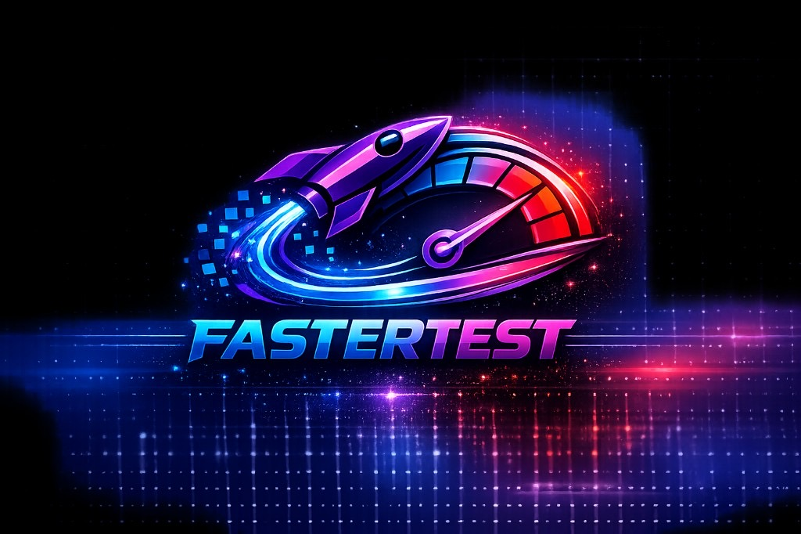

# FasterTest

<p align="center">
  
</p>

<p align="center">
  <b>Open-source load and stress testing platform powered by the k6 engine</b><br />
  Start tests from the browser · live metrics · cURL import · users &amp; RBAC · MySQL
</p>

<p align="center">
  <a href="https://github.com/alirezaedalat/fastertest/actions/workflows/ci.yml"></a>
  <a href="./LICENSE"></a>
  <a href="./package.json"></a>
  <a href="https://k6.io"></a>
  <a href="https://github.com/alirezaedalat/fastertest/stargazers"></a>
</p>

> **Independence notice:** FasterTest is an independent open-source project that uses the k6
> load-testing engine. Grafana, k6, and their associated marks are trademarks of Grafana Labs.
> FasterTest is not affiliated with, endorsed by, or sponsored by Grafana Labs. FasterTest is not an
> official Grafana or k6 product. FasterTest application source remains under the
> [ISC License](./LICENSE); k6 remains under its own license (AGPL-3.0). Bundled third-party
> components retain their own licenses — see [THIRD_PARTY_NOTICES.md](./THIRD_PARTY_NOTICES.md).

<p align="center">
  <a href="#quick-start"><b>Quick Start</b></a> ·
  <a href="#features">Features</a> ·
  <a href="#docker">Docker</a> ·
  <a href="docs/API.md">API</a> ·
  <a href="CONTRIBUTING.md">Contributing</a>
</p>

---

## Why FasterTest?

Most people run k6 from the CLI. **FasterTest** gives your team a secure panel on top of k6:

| Without FasterTest                  | With FasterTest                                 |
| ----------------------------------- | ----------------------------------------------- |
| Everyone shares scripts + CLI flags | One UI: pick scenario, VUs, duration, **Start** |
| Hard to invite non-CLI users        | JWT login, roles, invites, audit log            |
| Live output = terminal scrollback   | Live metrics over WebSocket                     |
| cURL → k6 by hand                   | **cURL import** (single or chain)               |

> **k6 still generates the load on the machine (or container) where the server runs.** Browsers only
> talk to the UI.

---

## Features

- **Web UI** — start / stop / pause / resume, live metrics, history
- **cURL import** — paste a cURL (or multi-step chain) → runnable k6 scenario
- **Auth & RBAC** — `admin`, `tech-lead`, `developer`, `qa`, `pm`
- **User management** — invites, password resets, audit log
- **MySQL storage** (recommended) — JSON file fallback for quick demos
- **Report retention** — automatic cleanup under `reports/`
- **Deploy-ready** — Docker Compose, Linux VM + systemd, nginx examples

---

## Quick Start

### Prerequisites

| Tool    | Version                      |
| ------- | ---------------------------- |
| Node.js | ≥ 18 (20 LTS — see `.nvmrc`) |
| npm     | ≥ 8                          |
| k6      | ≥ 1.7 (`npm run install:k6`) |
| Docker  | Optional (MySQL)             |

### 1. Clone & install

```bash
git clone https://github.com/alirezaedalat/fastertest.git
cd fastertest
npm ci
npm run install:k6
```

### 2. Configure

```bash
cp env.example .env
node -e "console.log(require('crypto').randomBytes(48).toString('hex'))"
```

Put the printed value into `.env` as `JWT_SECRET`, then set at least:

```dotenv
JWT_SECRET=<paste-here>
APP_BASE_URL=http://localhost:3001
ALLOWED_ORIGINS=http://localhost:3001
UI_PORT=3001
```

**Database is optional.**

| Mode                              | What to do                                                                       |
| --------------------------------- | -------------------------------------------------------------------------------- |
| **Quick start (no Docker)**       | Do **not** set `MYSQL_*`. Users/invites/audit are stored in local `data/*.json`. |
| **MySQL (recommended for teams)** | Start DB with Docker, then add `MYSQL_*` to `.env` (below).                      |

#### Option A — no database (simplest)

Skip Docker. Go straight to step 3.

#### Option B — MySQL via Docker

```bash
docker compose up -d mysql
```

Add to `.env`:

```dotenv
MYSQL_HOST=127.0.0.1
MYSQL_PORT=3307
MYSQL_USER=loadtest
MYSQL_PASSWORD=loadtest
MYSQL_DATABASE=loadtest
# Compose also requires a root password (no insecure defaults):
# MYSQL_ROOT_PASSWORD=change-me-root
```

### 3. Seed admin & run

```bash
npm run seed:admin -- admin 'YourStr0ng!Pass'
npm run ui
```

Open **http://localhost:3001** → login → run **Sample: HTTP GET**.

```bash
npm test          # unit + integration
npm run test:smoke  # k6 smoke (needs k6)
```

---

## Docker

Set secrets in `.env` first (Compose refuses insecure defaults):

```dotenv
MYSQL_ROOT_PASSWORD=change-me-root
MYSQL_PASSWORD=change-me-app
JWT_SECRET=generate-a-long-random-secret
```

**MySQL only** (best for local app development):

```bash
docker compose up -d mysql
npm run ui
```

**Full stack** (app + MySQL, pinned k6 **v1.8.0** with SHA256 verification):

```bash
docker compose --profile full up -d --build
docker compose --profile full exec app node scripts/seed-admin.js admin 'YourStr0ng!Pass'
```

The app container runs as non-root with `dumb-init`, `cap_drop: ALL`, `no-new-privileges`, and a
read-only root filesystem (writable volumes for `reports`, `logs`, `data`, and `/tmp`).

---

## Deploy on a Linux VM

```bash
git clone https://github.com/alirezaedalat/fastertest.git /opt/fastertest
cd /opt/fastertest
sudo bash deploy/install-vm.sh /opt/fastertest
```

```bash
sudo systemctl status fastertest
sudo journalctl -u fastertest -f
```

---

## Project layout

```text
public/          Web UI (Vue)
server/          Express API + WebSocket + stores
tests/scenarios/ k6 scripts (sample included)
deploy/          systemd, nginx, VM install
docs/            API & guides
```

---

## Documentation

| Doc                                                        | Description                         |
| ---------------------------------------------------------- | ----------------------------------- |
| [UI_PANEL.md](./UI_PANEL.md)                               | Dashboard guide                     |
| [docs/API.md](./docs/API.md)                               | REST + WebSocket                    |
| [docs/BEST_PRACTICES.md](./docs/BEST_PRACTICES.md)         | Load-testing practices              |
| [docs/LEGAL.md](./docs/LEGAL.md)                           | Licensing / k6 redistribution notes |
| [docs/TRADEMARKS.md](./docs/TRADEMARKS.md)                 | Trademark & branding checklist      |
| [docs/RELEASE_COMPLIANCE.md](./docs/RELEASE_COMPLIANCE.md) | Pre-release compliance checklist    |
| [THIRD_PARTY_NOTICES.md](./THIRD_PARTY_NOTICES.md)         | Third-party / k6 AGPL notices       |
| [CONTRIBUTING.md](./CONTRIBUTING.md)                       | How to contribute                   |
| [SECURITY.md](./SECURITY.md)                               | Vulnerability reporting             |
| [CODE_OF_CONDUCT.md](./CODE_OF_CONDUCT.md)                 | Community standards                 |
| [docs/GROWTH.md](./docs/GROWTH.md)                         | How to publish & grow stars         |
| [CHANGELOG.md](./CHANGELOG.md)                             | Release notes                       |

---

## Contributing

PRs and issues are welcome — especially:

- Better sample scenarios
- UI/UX polish
- Docs & translations
- Integrations (Grafana, Slack, etc.)

```bash
npm run lint
npm test
```

See [CONTRIBUTING.md](./CONTRIBUTING.md).

---

## Security notes

- Never commit `.env` or database dumps
- Rotate `JWT_SECRET` per deployment
- Only load-test systems you are authorized to test
- Prefer MySQL for shared / production installs

---

## License

ISC — see [LICENSE](./LICENSE).

Third-party components (including the k6 engine used by Docker images) are listed in
[THIRD_PARTY_NOTICES.md](./THIRD_PARTY_NOTICES.md). Docker images that bundle k6 include both the
FasterTest ISC text and the full k6 AGPL-3.0 text under `/usr/share/licenses/`. See
[docs/LEGAL.md](./docs/LEGAL.md).

## Authors

FasterTest Contributors
